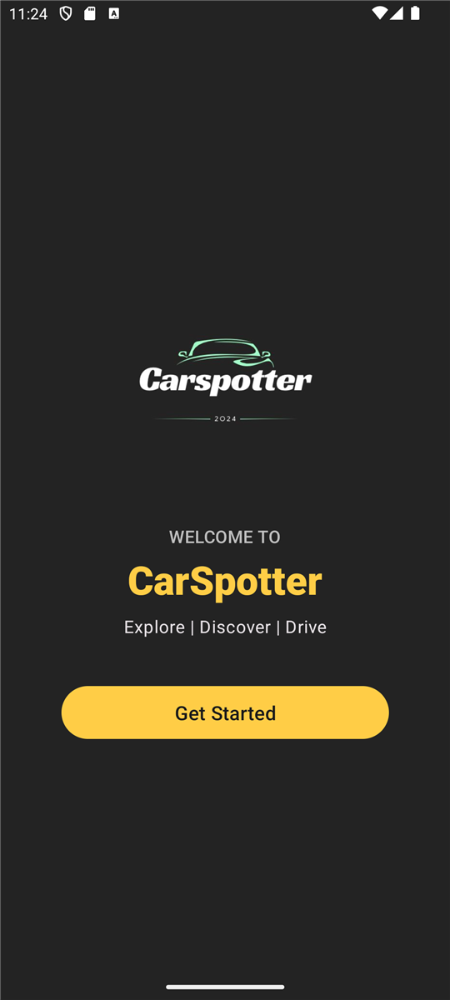
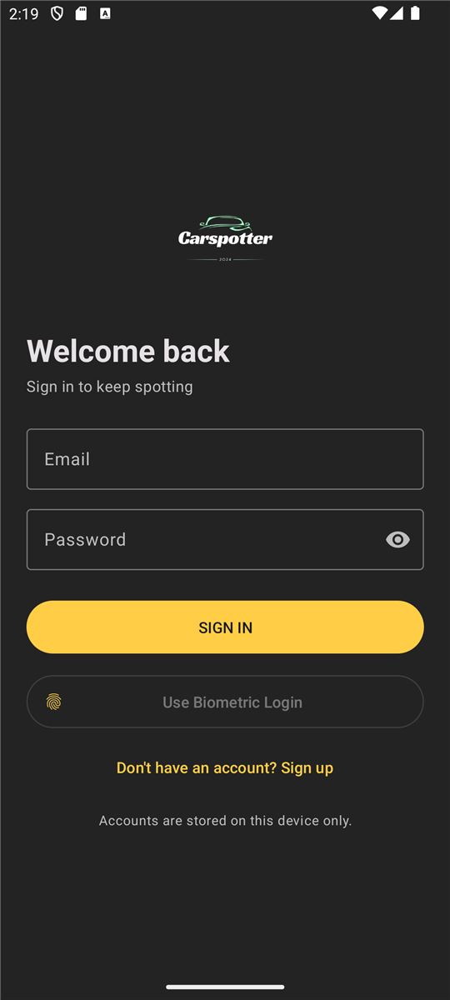
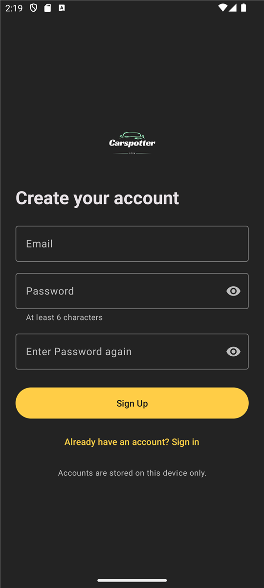
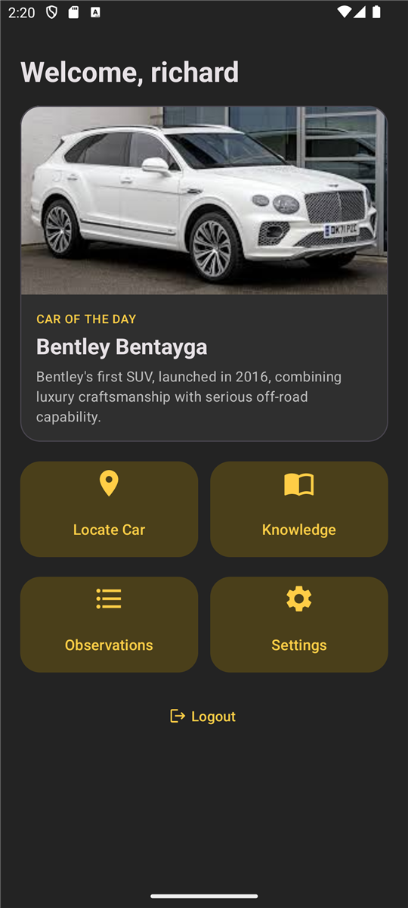
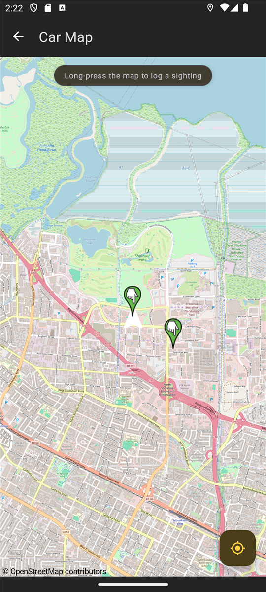
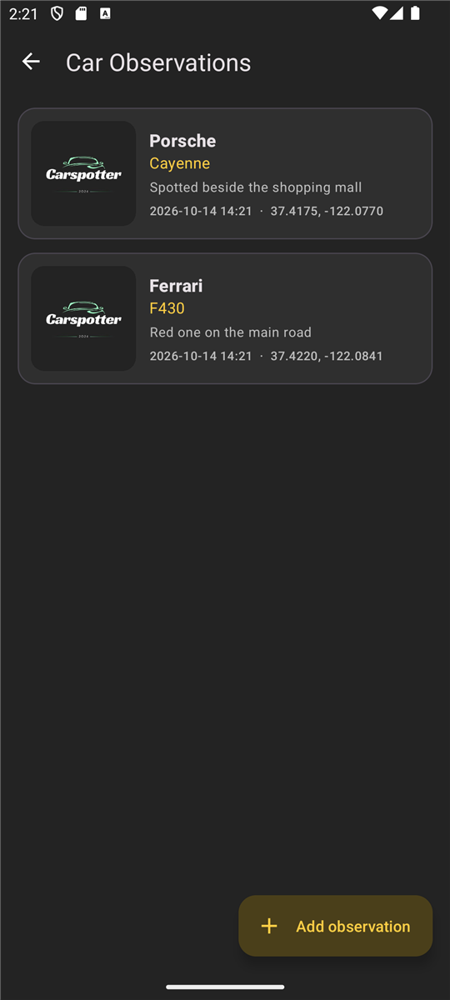
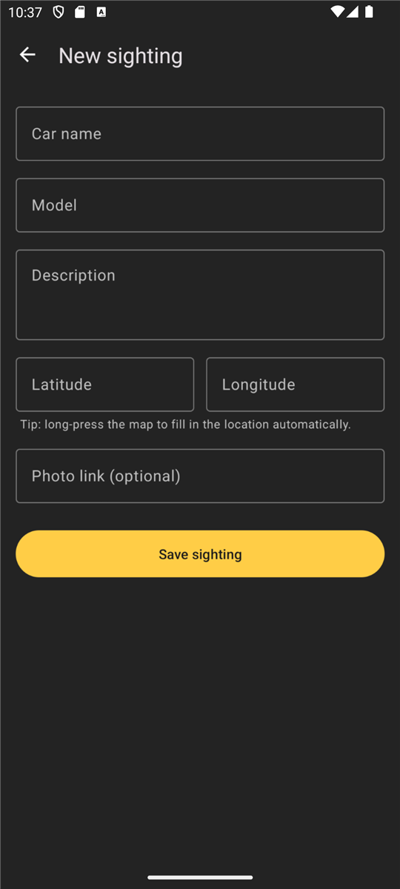
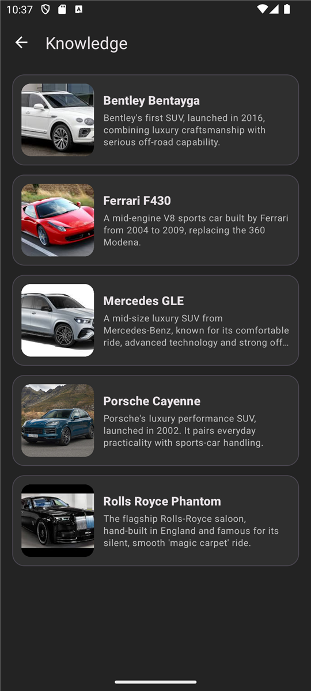
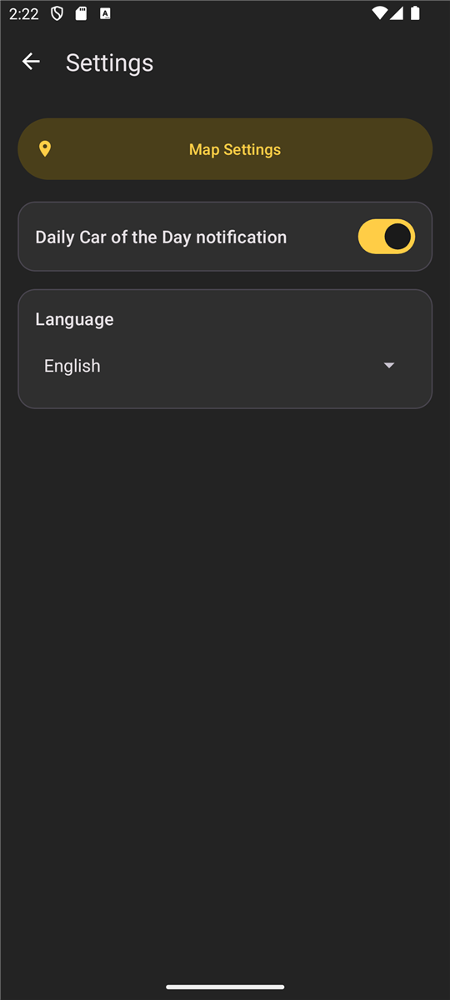

# CarSpotter

CarSpotter is an Android app for car enthusiasts. Spot a car, record where you saw it, and see your
sightings on a map.

It runs **entirely on the device**: no backend, no API keys and no accounts to set up. Clone it,
press Run, and it works.

**Platform:** Android only (Kotlin, minSdk 25, targetSdk 34).

**Demo videos:** [Part 2](https://youtu.be/0jAEoab_lcU) · [Part 3 (final)](https://youtu.be/jNvYGc3tQao)

## Team (OPSC7312)

| Student number | Name |
| --- | --- |
| ST10090394 | Richard Pettitt |
| ST10133787 | Ntando Ngubeni |
| ST10090100 | Phemelo Sebopela |
| ST10143427 | Azile Nzimande |
| ST10050374 | Chelsea Lennet |
| ST10090454 | Muaaz Jassat |

## Features

- **Accounts:** register and sign in with an email and password. Several people can have an account
  on one phone, and each sees only their own sightings.
- **Biometric sign-in:** fingerprint or face unlock signs the phone's owner back in to the account
  last used on the device.
- **Dashboard** with a random "Car of the Day".
- **Map** on OpenStreetMap showing your location and your saved sightings.
  **Long-press anywhere** on the map to log a sighting at that spot.
- **Sightings:** add a car name, model, description, coordinates and an optional photo link, then
  browse them newest first.
- **Knowledge:** a built-in list of cars with photos.
- **Daily notification:** a "Car of the Day" notification at 09:00, which you can switch off in Settings.
- **Settings:** switch the app between English, isiZulu and Afrikaans, and save distance and unit
  preferences.
- **Works offline:** everything is stored on the device. Only the map tiles and photo links need
  a connection.

### Not implemented

Google single sign-on and turn-by-turn navigation were planned but are not in the app.

## Screenshots

<table>
  <tr>
    <td align="center"><br><sub>Welcome</sub></td>
    <td align="center"><br><sub>Sign in</sub></td>
    <td align="center"><br><sub>Register</sub></td>
  </tr>
  <tr>
    <td align="center"><br><sub>Dashboard</sub></td>
    <td align="center"><br><sub>Map</sub></td>
    <td align="center"><br><sub>Sightings</sub></td>
  </tr>
  <tr>
    <td align="center"><br><sub>Add a sighting</sub></td>
    <td align="center"><br><sub>Knowledge</sub></td>
    <td align="center"><br><sub>Settings</sub></td>
  </tr>
</table>

## Running the project

You need **Android Studio** and an Android phone or emulator.

> **Use JDK 17 (or 21) for Gradle.** This project uses Gradle 8.7 and Kotlin 1.9, which can't run on
> JDK 25. Recent Android Studio versions bundle JDK 25, so if the Gradle sync fails with
> `IllegalArgumentException: 25.0.x`, open **Settings → Build, Execution, Deployment → Build Tools →
> Gradle** and set **Gradle JDK** to a 17 or 21 JDK (Android Studio can download one from that
> dropdown).

1. Clone the repo and open it in Android Studio:
   ```bash
   git clone https://github.com/MrPettitt/OPSC7312-Car-Spotter.git
   ```
2. Press **Run**. There is nothing else to configure.

From the command line (with `JAVA_HOME` pointing at JDK 17 or 21):

```bash
./gradlew testDebugUnitTest   # unit tests
./gradlew assembleDebug       # debug APK in app/build/outputs/apk/debug/
```

## How it works

| Need | How it's done | Cost |
| --- | --- | --- |
| Map | [OpenStreetMap](https://www.openstreetmap.org) tiles via [osmdroid](https://github.com/osmdroid/osmdroid) | Free, no API key |
| Accounts and sightings | Room (SQLite) on the device | Free |
| Passwords | Never stored. Only a salted PBKDF2 hash is kept (120,000 iterations) | n/a |
| Notifications | WorkManager schedules them on the phone | Free, no server |

**About the map:** OpenStreetMap's public tile servers are meant for light use, and they answer
HTTP 403 to apps that don't identify themselves, which is why the app sends a `CarSpotter/1.0 (...)`
user agent (keep it if you rename the project). If the app ever gets real traffic, use a tile provider
or host your own; see the [tile usage policy](https://operations.osmfoundation.org/policies/tiles/).
The required credit "© OpenStreetMap contributors" is shown on the map.

## Project layout

```
app/src/main/java/com/example/carspotteropsc7312poe/
├── CarSpotterApp.kt            App start-up: notification channel and daily schedule
├── data/
│   ├── SampleCars.kt           Built-in cars
│   ├── auth/                   AccountManager, SessionManager, PasswordHasher
│   ├── local/                  Room database (AppDatabase and its DAOs)
│   └── model/                  Car, User, Observation
├── notifications/              NotificationScheduler, DailyCarWorker
├── ui/
│   ├── welcome/                Launcher screen (WelcomeActivity)
│   ├── auth/                   LoginActivity, RegistrationActivity
│   ├── dashboard/              DashboardActivity
│   ├── map/                    MapActivity (osmdroid)
│   ├── observation/            Sighting list, add form, adapter
│   ├── knowledge/              KnowledgeActivity
│   └── settings/               SettingsActivity, MapSettingsActivity
└── util/                       InputValidator, small UI helpers
```

Layouts follow the screen they belong to: `activity_welcome.xml`, `activity_map.xml`,
`activity_observation_list.xml`, `item_observation.xml`, and so on.

## Known limitations

This is a portfolio project, so some things are deliberately simple:

- **Accounts live on one device.** They are a demo of sign-up and sign-in, not shared between phones.
  There is no password reset, and uninstalling the app deletes its accounts and sightings.
- **Notifications are scheduled on the phone**, not pushed from a server.
- Photos are links you paste, not uploads.
- Saved map settings (units, maximum distance) are stored but not yet used to filter the map.
- The Knowledge list only contains five sample cars.
- The Zulu and Afrikaans translations should be checked by a native speaker.

## Tests and CI

Unit tests cover input validation, password hashing and the notification schedule.
[`.github/workflows/main.yml`](.github/workflows/main.yml) runs them, runs lint, and builds a debug
APK on every push to `main`.

## References

The research and tutorials used while building the app are listed in
[docs/REFERENCES.md](docs/REFERENCES.md).
